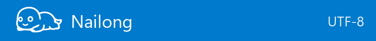

# Nailong

Adds a tiny Nailong to your status bar.

The character is drawn as a custom icon font and animates while you type.

Use the `Toggle Nailong` command to remove it from the status bar.

## Real demo

## Notes

- Icons are contributed directly through `contributes.icons`; the optional **Nailong Icons** product icon theme is also included.
- The icon font is built from the SVGs in `assets/frames/` by the scripts in `assets/build/`.

## Disclaimer

Unofficial, non-commercial fan project. Not affiliated with or endorsed by the rights holders of Nailong (奶龙). The MIT license covers the source code only, not the character artwork.
